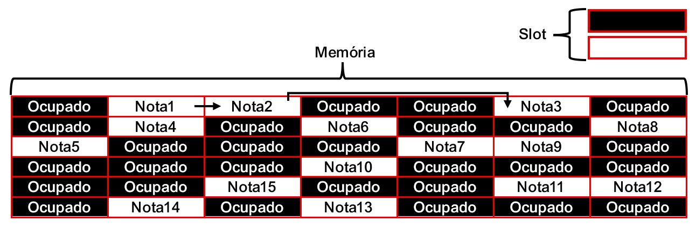
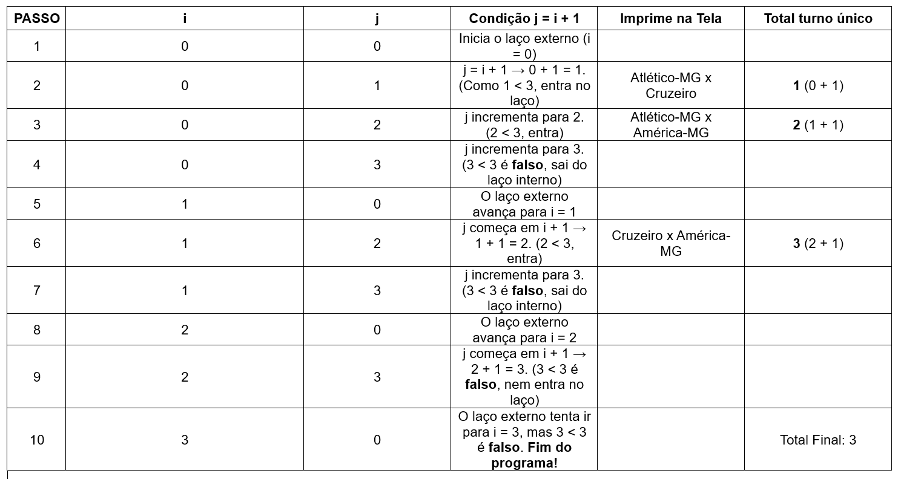
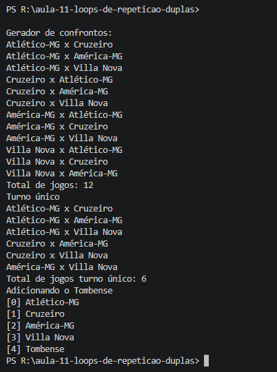
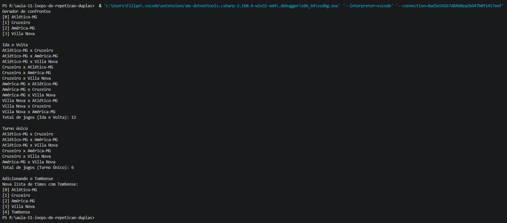
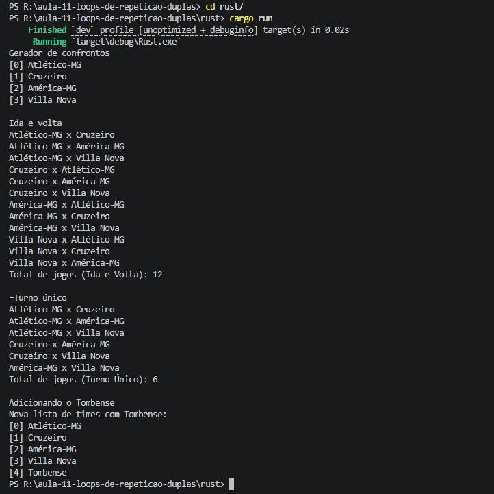

# Relatório - Aula 11 – Loops de repetição

## Parte 1: Análise da aula e respostas teóricas

1. **Por que utilizamos laços de repetição?**

   utilizamos laços de repetição quando queremos fazer um programa repetir uma determinada tarefa, por exemplo; suponhamos que estamos fazendo um cálculo complexo de mesa, e para não precisar ficar rodando o programa a cada cálculo, usamos o laço de repetição while (enquanto) com a variável “!= 0 (diferente de: 0)”, enquanto os valores captados pelo scanner forem diferentes de 0, o programa vai se encontrar em um estado de loop de repetição até que o usuário digite 0, encerrando o programa, como dito no vídeo **(youtube.com/watch?v=JzwH1EVyO1Q), no minuto; 09:19**. 

   ---

2. **Qual é a diferença entre while e do-while? Criem um exemplo de situação em que essa diferença seja importante.**

   A diferença entre **while** e **do-while** é que em **while** precisamos de uma condição inicial para rodar o programa, por exemplo; 

```java
  int valor = 1000;
   
   while (valor != 0) {

       valor = 0; 
   }
```
Ele precisa de uma condição de entrada, a condição fica no começo do laço, enquanto o do-while a condição fica no final do laço, por exemplo;

```java
   int valor;

   do {
    
   } while (valor != 0);

```

O **do-while** roda o bloco primeiro e verifica depois, o **while** roda o bloco já verificando a condição, se a condição for falsa o programa não inicia, e no **do-while** a mesma coisa, ele verifica o bloco e se a condição for falsa o programa não inicia, como dito no vídeo **(youtube.com/watch?v=JzwH1EVyO1Q), no minuto; 13:50**.

---

3. **No exemplo dos times em C#, por que são necessários dois laços?**

É necessário para evitar que os times se “enfrentem”, será usado um loop aninhado, para que na hora de imprimir no terminal, ele consiga distribuir os jogos sem que um time apareça jogando contra ele mesmo e tenha pelo menos 1 jogo contra todos os outros times.

---

4. **Qual é a função do if que impede confrontos de um time contra ele mesmo?**

A função do **if (se)**, é usada para quando temos duas listas, listaTimes e listaAdversarios, cada uma sendo identificada pela variável **int = i** ou **int = j**, sendo que se **i != j**, logo o problema de os times caírem contra eles mesmos é corrigido.

---

5. **Comparando os exemplos de Java, C# e Rust, indiquem duas diferenças de sintaxe e um conceito lógico que permanece igual.**

Duas diferenças de sintaxes que pudemos observar é que em Java usamos **“System.out.println()”** para imprimir no console e o CSharp se usa o **“Console.WriteLine()”** para imprimir.

Já o conceito lógico que permanece é o uso dos laços de repetição, usado para analisar os blocos de forma repetitiva infinitamente ou até atingir uma quantidade de passos pré-determinada, é igual nas três linguagens. 

---

## Parte 2: Leitura e relação com o livro (*Entendendo Algoritmos* - Aditya Bhargava)
*(Referência: BHARGAVA, Aditya. Entendendo Algoritmos: um guia ilustrado para programadores e outros curiosos. Capítulo 2: Memória, Arrays e Listas Encadeadas).*

1. **Como os elementos de um array são organizados e acessados?**

Os dados armazenados dentro de uma **array** são organizadas de forma numerada, você determina uma lista com quantidade de espaços na memória pré-selecionados, os dados são inseridos nesses espaços e lhe é atribuído um índice, **esse índice começa em 0**, a **array** permite que você acesse esses índices de forma aleatória, pois você sabe exatamente em qual índice está cada dado.

---

2. **Como os elementos de uma lista encadeada são organizados? Apresentem um desenho simples.**

As listas encadeadas são organizadas de forma dividida dentro dos slots da memória, não se sabe o índice onde o próximo dado está armazenado, sendo necessário percorrer cada dado para encontrar o endereço do próximo.



---

3. **Por que inserir ou excluir elementos pode exigir operações diferentes nessas duas estruturas?**

Porque a forma de distribuição dos dados de cada estrutura é diferente, em **listas encadeadas** você precisa apenas apagar o endereço que o dado anterior esta indicando, e em **arays** será necessário mover todos os dados quando um é apagado.

---

4. **Uma coleção chamada “lista” em uma linguagem é necessariamente uma lista encadeada? Pesquisem especificamente List de C# e Vec de Rust.**

Não necessáriamente, pesquisando usando o **Gemini**, descobrimos que existem **arrays dinâmicos**, blocos de memória adjacentes que se redimensionam automaticamente, o **CSharp** utiliza o **List<T>**, quando um **array** dinâmico de uma **List<T>** atinge seu limite de armazenamento, o **.NET** aloca um espaço de memória adjacente maior e copia o dados para lá.

Já em **Rust** usamos o **Vec<T>**, é a **array dinãmica** equivalente em **Rust**, assim como no **CSharp** os dados ficam guardados em blocos de memória adjacentes, mas em **Rust** funciona um pouco diferente, os dados ficam armazenados em um **Heap**, um monte, é uma área de memória maior, mais livre e desestruturada, e também temos a **Stack*, uma pilha, funciona como uma pilha de pratos, o último prato que entra é o último a sair, ela guarda variáveis,  locais de funções, parâmetros de métodos, tipos primitivos como números inteiros e booleanos.

---

5. **Para guardar os times e percorrê-los repetidamente, quais vantagens vocês identificam em uma estrutura baseada em array?**

Em uma **array** temos a vantagem de saber exatamente a quatidade de espaços na memória que iremos útilizar, por exemplo; se pegarmos os times do Brasileirão 2026, temos 20 times, criamos então uma **array** com 20 espaços reservados, e desses espaços, sabemos exatamente o endereço de cada um, sem precisar passar por todos para descobrir o endereço do próximo, você pode percorrer toda a lista sem problemas.

## Parte 3: Desafio prático — Gerador de confrontos

1. Por que o array de Java exigiu a criação de outro array?

Foi necessário criar outra array para mover os times da primeira lista para a segunda, já que uma array não permite alocar mais espaço quando já criada.

2. O que ficou mais simples com *List<string>* e *Vec<String>?*

Em CSharp e Rust, o processo de criar um novo array foi facilitado por conta das *array dinâmicas*, em *java* foi necessário criar uma nova *array* com espaço maior e copiar os dados para a nova *array*.

3. A facilidade de adicionar um elemento significa que essas estruturas são listas encadeadas? Justifiquem com a pesquisa realizada.

Não, essa facilidade se dá por que a lista dinâmica é um bloco reservado de memória adjacente, enquanto as listas encadeadas, são blocos de memória que para encontrar o proximo dado você precisa percorrer todos os outros primeiro.

---

## Parte 4: Comparação das sintaxes

### Criar a coleção em java
```java
String[] times = {"Atlético-MG", "Cruzeiro", "América-MG", "Villa Nova"}
```
---
### Criar a coleção em C#
```C#
List<string> times = new List<string> { "Atlético-MG", "Cruzeiro", "América-MG", "Villa Nova" }
```
---
### Criar a coleção em Rust
```Rust
 let mut times = vec!["Atlético-MG", "Cruzeiro", "América-MG", "Villa Nova"]
```
---
### Consultar a quantidade de elementos em java
```java
for (int i = 0; i < times.length; i++)
```
---
### Consultar a quantidade de elementos em C# 
```C#
for (int i = 0; i < times.Count; i++)
```
---
### Consultar a quantidade de elementos em Rust
```Rust
for i in 0..times.len()
```
---
### Acessar um elemento pelo índice em java
```java
System.out.println(times[i] + " x " + times[j])
```
---
### Acessar um elemento pelo índice em C#
```C#
Console.WriteLine($"{times[i]} x {times[j]}")
```
---
### Acessar um elemento pelo índice em Rust
```Rust
println!("{} x {}", times[i], times[j]);
```
---
### Escrever um laço para percorrer a coleção em Java
```java
for (int i = 0; i < times.length; i++) {
        timesComTombense[i] = times[i];
    }
```
---
### Escrever um laço para percorrer a coleção em C#
```C#
for (int i = 0; i < times.Count; i++)
```
---
### Escrever um laço para percorrer a coleção em Rust
```Rust
for i in 0..times.len() {
        println!("[{}] {}", i, times[i]);
    }
```
---
### Escrever dois laços aninhados em Java
```java
 for (int i = 0; i < total; i++) {
            for (int j = 0; j < total; j++) {
                if (i != j) {
                    System.out.println(times[i] + " x " + times[j]);
                    totalDeJogos++; 
                }
            }
        }
```
---
### Escrever dois laços aninhados em C#
```C#
 for (int i = 0; i < times.Count; i++)
            {
                for (int j = 0; j < times.Count; j++)
                {
                    if (i != j)
                    {
                        Console.WriteLine($"{times[i]} x {times[j]}");
                        totalIdaVolta++;
                    }
                }
            }
```
---
### Escrever dois laços aninhados em Rust
```Rust
 for i in 0..times.len() {
        for j in (i + 1)..times.len() {
            println!("{} x {}", times[i], times[j]);
            total_turno_unico += 1;
        }
    }
```
---
### Impedir confronto contra o próprio time em Java
```java
 if (i != j) {
    System.out.println(times[i] + " x " + times[j]);
        totalDeJogos++; 
}
```
---
### Impedir confronto contra o próprio time em C#
```C#
if (i != j)
    {
    Console.WriteLine($"{times[i]} x {times[j]}");
        totalIdaVolta++;
}
```
---
### Impedir confronto contra o próprio time em Rust
```Rust
if i != j { 
    println!("{} x {}", times[i], times[j]);
        total_ida_volta += 1;
}
```
---
### Acrescentar o quinto time em Java
```java
System.out.println("Adicionando o Tombense");

String[] timesComTombense = new String[5];
    for (int i = 0; i < times.length; i++) {
        timesComTombense[i] = times[i];
    }

    timesComTombense[4] = "Tombense";

    for (int i = 0; i < timesComTombense.length; i++) {
        System.out.println("[" + i + "] " + timesComTombense[i]);
}
```
---
### Acrescentar o quinto time em #
```C#
 Console.WriteLine("\nAdicionando o Tombense");
    times.Add("Tombense"); 

        Console.WriteLine("Nova lista de times com Tombense:");
            for (int i = 0; i < times.Count; i++)
            {
                Console.WriteLine($"[{i}] {times[i]}");
}
```
---
### Acrescentar o quinto time em Rust
```Rust
println!("\nAdicionando o Tombense");
    times.push("Tombense");

    println!("Nova lista de times com Tombense:");
    for i in 0..times.len() {
        println!("[{}] {}", i, times[i]);
}
```
---
### O que mudou na escrita dos programas e o que permaneceu igual no raciocínio utilizado para resolver o problema?

A mudança visível entre os programas foi as sintaxes de criação das arrays e impressão; String, List e Vec, e para impressão; println, WriteLine e println!  já a lógica de criação do código permanece a mesma para os três programas.

---

## Parte 4: Teste de mesa e validação



1. Por que a quantidade de combinações examinadas pode ser maior que a quantidade de jogos exibidos?

Isso acontece quando o programa não tem a restrição de if para evitar que os times caiam contra eles mesmos, e isso aumenta a quantidade de jogos.

2. O que acontece com a quantidade de confrontos quando acrescentamos um time?

Cada equipa nova adiciona ao campeonato tantos jogos quantos os que já existiam anteriormente, por exemplo, passar de 4 para 5 equipas aumenta o turno único de 6 para 10 jogos, somando mais 4 partidas.

3. As três linguagens produziram os mesmos jogos e totais? Caso contrário, identifiquem e corrijam a diferença.

Sim. Independentemente da sintaxe mudar entre Java, C# e Rust, a lógica do codigo não mudou.

---

## Evidências de execução das três versões.

### java


### C#


### Rust


---

## Um erro encontrado e como foi corrigido.

Erro encontrado: Ao tentar executar o programa em Rust, o terminal devolveu a mensagem error: could not find 'Cargo.toml'.

Causa: O terminal do editor estava aberto na pasta raiz geral do projeto e não dentro da pasta específica Rust/.

Como foi corrigido: O erro foi resolvido navegando para o diretório correto através do comando de mudança de pasta (cd Rust), permitindo que o cargo run localizasse o Cargo.toml e compilasse o código com sucesso.

## Contribuição e principal aprendizado - Filipe Dutra

Eu contribuí com a montagem do relatório, os desenhos e tabelas e com a criação dos códigos, a principal 

## Contribuição e principal aprendizado - Lucca Fabrini